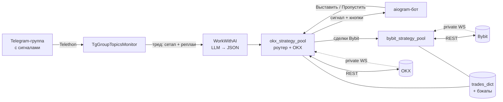

# PifSignals AI

Асинхронный торговый бот: читает торговые сигналы из Telegram-группы, разбирает их с помощью LLM в структурированные команды и после подтверждения в Telegram исполняет сделки на **Bybit** и **OKX** — с расчётом объёма от риска и сопровождением позиции через WebSocket.

## Зачем

В сигнальных группах трейдеры пишут сетапы свободным текстом, а потом дополняют их реплаями: «стоп в безубыток», «убираем лимитку», «закрываю остаток». Переносить всё это на биржу вручную медленно, и легко ошибиться. Бот берёт эту рутину на себя: понимает сообщение в контексте всего треда, выставляет нужные ордера и дальше сам ведёт сделку. Человек только подтверждает действие одной кнопкой.

## Стек

| Область | Технологии |
|---|---|
| Язык / рантайм | Python 3.9+, `asyncio` |
| Чтение Telegram | Telethon (userbot, forum-группа с топиками) |
| Бот управления | aiogram 3 (inline-кнопки, middleware, роутеры) |
| Разбор сигналов | DeepSeek через OpenAI SDK, JSON mode |
| Биржи | Bybit v5 (`pybit`), OKX (`okx`): REST + private WebSocket (`websockets`, HMAC-авторизация) |
| Инфраструктура | Docker, Docker Compose, YAML-конфиг, loguru, gzip-бэкапы состояния |

## Архитектура

Один процесс `asyncio`: независимые задачи общаются через очереди `asyncio.Queue`.



```
main.py                 # точка входа: поднимает все задачи и очереди
config.yaml             # настройки: баланс для риска, бэкапы, модель LLM (секреты — в .env)
Dockerfile, docker-compose.yml
utils/
  tg_group_topics_monitor.py  # чтение топиков группы, сборка тредов
  work_with_ai.py             # промпт и запросы к LLM
  trades_backup.py            # периодический бэкап состояния
exchanges/
  bybit/ okx/           # trade.py (REST), ws_connects.py (WS), ws_process.py (события ордеров), *_strategy.py (логика)
tg_bot/                 # aiogram: подтверждение сигналов, /setups, /stop, уведомления
```

## Как это работает

1. **Мониторинг.** Telethon слушает новые и отредактированные сообщения в выбранных топиках. Каждое сообщение привязывается к исходному сетапу (`root_id`) по цепочке реплаев и ссылкам `t.me`, поэтому в LLM уходит весь тред, а не одна реплика.
2. **Разбор.** LLM возвращает строгий JSON: `action` (`place_new_order`, `enter_now`, `stop_breakeven`, `cancel`, `close_entire`, `info`, `help`), монета, направление, 1–2 входа, SL, до 3 тейков, риск.
3. **Подтверждение.** Бот присылает разобранный сигнал с исходным текстом и кнопками «Выставить» / «Пропустить». Отвечает он только владельцу.
4. **Выбор биржи.** Основная биржа Bybit. Если монеты там нет, сделка уходит на OKX. Если по монете уже есть сделка на Bybit, новая открывается на OKX.
5. **Исполнение.** Объём считается от риска: % депозита делится на расстояние до стопа. Плечо ограничено так, чтобы ликвидация была дальше стопа (не больше 20x). Цена и количество округляются под tick size и qty step, учитывается минимальный номинал. Поддерживаются двухфазный вход и несколько тейков.
6. **Сопровождение.** Private WebSocket присылает события ордеров. После исполнения входа бот ставит SL и тейки, обрабатывает частичные исполнения, переносит стоп в безубыток, отменяет лимитки и закрывает остаток. О каждом шаге приходит уведомление в Telegram.
7. **Управление.** `/setups` показывает активные сетапы по биржам и позволяет удалить лишние. `/stop` корректно закрывает WebSocket-соединения и все задачи.

## Ключевые решения

- **LLM вместо регулярок.** Сигналы пишут люди, и формат постоянно плавает. Фиксированный список действий и JSON mode делают ответ модели предсказуемым.
- **Human-in-the-loop.** Ни один ордер не выставляется без подтверждения, так ошибка модели не превращается в сделку.
- **Очереди вместо прямых вызовов.** Мониторинг, AI, биржи и бот развязаны: каждый компонент можно запустить и отладить отдельно, внешний брокер не нужен.
- **Синхронные SDK бирж в `asyncio.to_thread`.** REST-вызовы не блокируют event loop, и WebSocket и бот продолжают работать.
- **Состояние в памяти + бэкапы.** Состояние сделок периодически сохраняется в `logs/backups` (gzip, с ротацией), чтобы его можно было восстановить после сбоя.
- **Секреты отдельно от настроек.** Ключи лежат только в `.env`, настройки — в `config.yaml`. В Docker-образ не попадает ни то ни другое: всё подключается при запуске.

## Запуск в Docker

```bash
cp .env.example .env                                     # ключи Telegram, LLM и бирж
docker compose run --rm bot python utils/auth_debug.py   # один раз: вход в Telegram
docker compose up -d --build
docker compose logs -f
```

- Шаг входа создаёт сессию Telethon в `tg_sessions/` и пересоздаёт её, если она уже была. Если файл сессии уже есть, шаг не нужен.
- `config.yaml`, `tg_sessions/` и `logs/` подключены как volume: настройки меняются без пересборки (`docker compose restart`), сессия и бэкапы переживают перезапуск.
- `docker compose down` и `/stop` в боте корректно закрывают WebSocket-соединения. После `/stop` контейнер не перезапускается, после падения поднимается сам (`restart: on-failure`).

## Локальный запуск

```bash
python -m venv .venv && source .venv/bin/activate
pip install -r requirements.txt
cp .env.example .env
python main.py         # при первом запуске Telethon запросит код входа
```

`utils/list_chats.py` выводит ID групп и топиков, чтобы заполнить `TG_GROUP_ID` и `TG_TOPIC_IDS`.

> Личный pet-проект. Не является финансовой рекомендацией: торговля с плечом связана с высоким риском.
